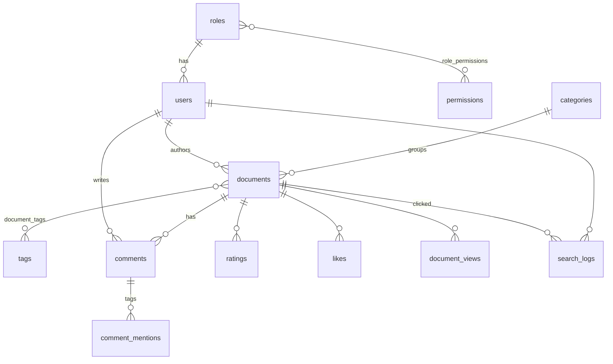

# Enterprise Document & Research Repository

A full-stack web application for publishing and finding internal policies, procedures and research reports.
Phase 1 delivers complete CRUD, authentication and Role-Based Access Control (RBAC) on top of a clean
**Document Store** and a standardized **Search & Click Log**. Phase 2 adds a **search engine written from
scratch** — tokenization, Porter stemming, a positional inverted index, TF-IDF and BM25F ranking, snippets,
spelling suggestions — and measures it against hand-judged queries (see [section 7](#7-phase-2--search-engine)).

| Layer | Technology |
|---|---|
| Backend | Python 3.11+ · **FastAPI** (RESTful API, OpenAPI docs at `/docs`) · SQLAlchemy 2.0 · JWT (PyJWT) · bcrypt |
| Database | **PostgreSQL 16** (document store, logs, RBAC) |
| Frontend | **React 18** + React Router + Vite, responsive (desktop → 360 px mobile) |
| Tests | pytest + FastAPI TestClient against a real PostgreSQL database (49 tests) |
| DevOps | Docker Compose (db + api + web), Git |

---

## 1. Quick start

### Option A — Docker (one command)

```bash
docker compose up --build
```

* Web app: <http://localhost:5173>
* API docs (Swagger): <http://localhost:8000/docs>

Demo data is seeded automatically the first time the backend starts.

### Option B — Run locally

Prerequisites: Python 3.11+, Node 18+, PostgreSQL 14+.

```bash
# 1. Database
psql -U postgres -c "CREATE USER docrepo WITH PASSWORD 'docrepo' CREATEDB;"
psql -U postgres -c "CREATE DATABASE docrepo OWNER docrepo;"

# 2. Backend
cd backend
python -m venv .venv
source .venv/bin/activate          # Windows: .venv\Scripts\activate
pip install -r requirements.txt
cp .env.example .env               # edit DATABASE_URL / SECRET_KEY if needed
python -m seed.seed --reset        # create tables + load demo data
uvicorn app.main:app --reload --port 8000

# 3. Frontend (new terminal)
cd frontend
npm install
npm run dev                        # http://localhost:5173 (proxies /api → :8000)
```

### Demo accounts

All accounts use the password **`Password123!`**

| Username | Role | What to try |
|---|---|---|
| `superadmin` | Super Admin | Users, role permissions matrix, global settings, system log |
| `content.manager` | Content Manager | Create/edit/delete documents, publish/unpublish, categories & tags |
| `editor.hoang` | Content Manager | (second editor) |
| `moderator` | Moderator | Comment queue, reports/flags, spam keyword filter |
| `seo.analyst` | Data & SEO Specialist | SEO metadata editor, analytics dashboard, search & click log |
| `sarah.lee`, `john.carter`, … | Member | Comment, @mention, like, rate, report, edit profile |

---

## 2. Requirements coverage

### A. Client / user interface

| Requirement | Where |
|---|---|
| Home & directory: paginated latest items with summaries | `/` — 10 per page (configurable), newest first, summary + author + date + views + tags |
| Detail view: full content, image, metadata (author, date, view count, categories, tags) | `/documents/:slug` — view counter increments on each visit, related documents |
| Registration, login, profile management | `/register`, `/login`, `/profile` (edit details, avatar URL, change password) |
| Commenting | Threaded comments (one reply level), edit/delete own comments |
| Rating / liking | 1–5 star rating and like toggle per user |
| User tagging | `@username` mentions with autocomplete; mentioned users see them in **Profile → Mentions** |
| Keyword search (LIKE / regex) | Phase 1: `ILIKE` on title, summary and content. Still available as the "Exact words" option; Phase 2 ranks with BM25 by default (section 7) |
| Filters: category, tag, date range | Sidebar filters (combinable with the keyword), plus document type and sort |

### B. Admin interface (RBAC)

| Role | Core responsibilities | Implemented in `/admin` |
|---|---|---|
| **Super Admin** | Manage users/roles, assign permissions, view system logs, global settings | Users (create, change role, deactivate, reset password, delete), Roles & permissions matrix (editable), System log (audit trail incl. failed logins), Global settings |
| **Content Manager** | Full CRUD on content, publish/unpublish, taxonomy | Documents list + editor, Publish/Unpublish/Archive, Categories & tags CRUD |
| **Moderator** | Review comments, handle flags/reports, spam control | Comment queue (pending/reported/spam/hidden), Reports (resolve, hide target, dismiss), Spam keyword blocklist (auto-flags new comments) |
| **Data & SEO Specialist** | SEO metadata, analytics dashboards | SEO editor with issue checker & search-result preview, Analytics (views, searches, CTR, top/zero-result queries), Search & click log + CSV export |

RBAC is **permission-based**: roles are rows in the database and each role owns a set of permission codes.
Every protected endpoint declares the permission it needs, so the Super Admin can change what a role may do
at runtime. Safety rules: the last active Super Admin cannot be demoted/deleted, and the Super Admin role
always keeps `users.manage` and `roles.manage`.

| Permission | Super Admin | Content Manager | Moderator | Data & SEO | Member |
|---|:-:|:-:|:-:|:-:|:-:|
| `users.manage`, `roles.manage`, `logs.view`, `settings.manage` | ✔ | | | | |
| `documents.create/update/delete/publish`, `taxonomy.manage` | ✔ | ✔ | | | |
| `documents.read_all` (see drafts) | ✔ | ✔ | | ✔ | |
| `comments.moderate`, `reports.manage`, `spam.manage` | ✔ | | ✔ | | |
| `seo.manage`, `analytics.view` | ✔ | | | ✔ | |

---

## 3. Data schema & Phase 2 preparation



### Documents table (`documents`)

| Required field | Column |
|---|---|
| id | `id` (PK) |
| title | `title` |
| content (plain text / HTML) | `content` — plain text, paragraphs separated by blank lines |
| summary | `summary` |
| category_id | `category_id` → `categories.id` |
| tags | many-to-many via `document_tags` → `tags` |
| author | `author_id` → `users.id` |
| created_at | `created_at` (timestamptz) |
| views_count | `views_count` |

Extra columns: `slug`, `doc_type`, `department`, `status` (draft/published/archived), `published_at`,
`updated_at`, `cover_image_url`, SEO fields (`seo_title`, `seo_description`, `seo_keywords`, `cover_image_alt`).

**Flat corpus view for the indexer** — `search_corpus` exposes exactly the required fields in one row per
document (tags as a text array, author as a display name):

```sql
SELECT id, title, content, summary, category_id, tags, author, created_at, views_count
FROM search_corpus WHERE status = 'published';
```

### Search & click log (`search_logs`)

| Required field | Column |
|---|---|
| user_id | `user_id` (NULL for guests) |
| query_string | `query_string` |
| clicked_doc_id | `clicked_doc_id` (NULL on search events) |
| timestamp | `timestamp` |

Extra columns for relevance work: `event_type` (`search` / `click`), `session_id` (groups a query with its
clicks), `rank_position` (1-based position of the clicked result → position-bias correction),
`results_count` (zero-result detection) and `filters` (JSONB).
The frontend logs a `search` event whenever a keyword search runs and a `click` event when a result is
opened. Export: `GET /api/analytics/search-logs.csv` or the **Download CSV** button.

### Seed data

`python -m seed.seed --reset` loads deterministic, realistic data (no Lorem Ipsum):

* **61 documents** (55 published, 4 drafts, 2 archived) written for a fictional company — HR policies,
  security standards, architecture decision records, runbooks, postmortems, finance procedures, legal
  policies, market research and product requirements; ~1,250 characters each
* 8 categories, 105 tags, 13 users across all 5 roles
* ~110 comments with replies and @mentions, ~210 likes, ratings, ~6,500 view events over 45 days
* **420 search events + ~270 click events** with realistic position bias, including zero-result queries
* Moderation examples: a spam comment, a pending comment, open reports

---

## 4. API overview

Interactive documentation: **<http://localhost:8000/docs>**. Authentication uses
`Authorization: Bearer <token>` from `/api/auth/login`.

| Method | Path | Access |
|---|---|---|
| POST | `/api/auth/register` · `/api/auth/login` | public |
| GET/PUT | `/api/auth/me` · POST `/api/auth/change-password` | signed in |
| GET | `/api/me/mentions` · POST `/api/me/mentions/read` | signed in |
| GET | `/api/documents` (`q`, `algo`=bm25/tfidf/like, `category`, `tag`, `doc_type`, `date_from`, `date_to`, `sort`=relevance/latest/…, `page`, `page_size`) | public |
| GET | `/api/documents/{id or slug}` · `/related` · `/comments` · `/engagement` | public |
| POST/PUT/DELETE | `/api/documents/{id}/comments` · `/api/comments/{id}` · `/like` · `/rating` · POST `/api/reports` | signed in |
| GET | `/api/categories` · `/api/tags` · `/api/documents/doc-types` · `/api/documents/popular` · `/api/site` | public |
| POST | `/api/logs/click` | public |
| GET/POST/PUT/DELETE | `/api/admin/documents…` · PATCH `/api/admin/documents/{id}/status` | `documents.*` |
| GET/POST/PUT/DELETE | `/api/admin/categories…` · `/api/admin/tags…` | `taxonomy.manage` |
| GET/PATCH/DELETE | `/api/moderation/comments…` · `/stats` | `comments.moderate` |
| GET/PATCH | `/api/moderation/reports…` | `reports.manage` |
| GET/POST/DELETE | `/api/moderation/spam-keywords…` | `spam.manage` |
| GET/PUT | `/api/seo/documents…` | `seo.manage` |
| GET | `/api/analytics/summary` · `/search-logs` · `/search-logs.csv` | `analytics.view` |
| GET/POST/PUT/DELETE | `/api/admin/users…` | `users.manage` |
| GET/PUT | `/api/admin/roles` · `/api/admin/permissions` · `/api/admin/roles/{id}/permissions` | `roles.manage` |
| GET | `/api/admin/system-logs` | `logs.view` |
| GET/PUT | `/api/admin/settings…` | `settings.manage` |
| GET | `/api/admin/search/stats` · `/term` · `/analyze` · `/explain` · `/evaluate` · `/evaluate/tune` | `search.manage` |
| POST/PUT | `/api/admin/search/rebuild` · `/api/admin/search/config` | `search.manage` |

---

## 5. Tests

```bash
psql -U docrepo -d docrepo -c "CREATE DATABASE docrepo_test;"   # once
cd backend
pytest -q          # uses TEST_DATABASE_URL, default .../docrepo_test (wiped and re-seeded)
```

The suite covers pagination, detail/view counting, draft visibility, keyword search with filters and
logging, click logging, the Phase 2 corpus view, registration/login/profile, validation, a full RBAC matrix
(every admin endpoint × every role), document CRUD and publishing, taxonomy, comments/mentions/likes/
ratings/reports, the spam filter, moderation, SEO, analytics and every Super Admin function.

Phase 2 adds `test_search_engine.py` (stemmer against the paper's examples, tokenizer, index statistics,
BM25 checked against a hand calculation, TF-IDF bounds, query language, evaluation metrics) and
`test_search_api.py` (ranked search vs. LIKE, stemming, filters + sorting, phrases/exclusions, spelling
suggestion, logging, automatic re-indexing on create/unpublish, admin tools and permissions, config).

---

## 6. Project structure

```
backend/
  app/
    main.py            FastAPI app, CORS, router registration
    models.py          SQLAlchemy models (documents, search_logs, RBAC, …)
    schemas.py         Pydantic request/response models
    permissions.py     Permission catalogue + default roles + default settings
    deps.py            Auth dependencies and require_permissions()
    db_init.py         Creates tables, the search_corpus view and the RBAC baseline
    routers/           auth, documents, engagement, taxonomy, moderation, admin, analytics, search
    search/            Phase 2 engine: tokenizer, stemmer, index, query, ranking, engine, evaluation
      qrels.json       32 hand-judged queries used for evaluation
  seed/                seed.py + 4 files of realistic documents
  tests/               pytest suite (real PostgreSQL)
frontend/
  src/
    pages/             Home, DocumentPage, Login, Register, Profile
    pages/admin/       Workspace pages, one per responsibility
    components/        Layout, DocCard, Comments, Pagination, …
    api/client.js      fetch wrapper, session id, click logging
docker-compose.yml
```

## 7. Phase 2 — Search engine

The keyword search no longer uses `ILIKE`. `GET /api/documents?q=…` now goes through a search engine
implemented from scratch in [`backend/app/search/`](backend/app/search) — no Elasticsearch, no PostgreSQL
full-text search, no NLP library — so every step can be read and explained. The API contract is unchanged;
results simply gain a `score` and `highlights`, and the page gains `algorithm`, `took_ms` and `suggestion`.

```
 search_corpus view ──► analyse ──► positional inverted index ──► rank (BM25F / TF-IDF) ──► filter, sort, page
 (published docs)        │                       ▲                         │
                         │                query ─┘ (same analyser)         └─► snippet + highlight ranges
 normalise → tokenise → stop words → Porter stem                               did-you-mean (edit distance)
```

### 7.1 Text analysis — `tokenizer.py`, `stemmer.py`

| Step | What happens | Example |
|---|---|---|
| Normalise | lower-case, strip accents (`é→e`, `đ→d`), offsets kept 1:1 with the original text | `Café` → `cafe` |
| Tokenise | runs of letters/digits; possessive `'s` removed; hyphens split | `e-commerce` → `commerce` |
| Stop words | ~130 English function words removed, **but positions still counted** so phrases keep their gaps | `the`, `of`, `and` |
| Stem | Porter (1980) suffix stripping, written from the paper and checked against NLTK on all 2,842 corpus words | `policies`, `policy` → `polici` |

The same `analyze()` runs on documents and queries, which is what makes `clicking` match `clicked`.

### 7.2 Inverted index — `index.py`

```
postings[term][doc_id][field] = [positions]      fields: title, tags, summary, content, author
```

From this one structure the engine reads `tf`, `df`, field lengths and average field lengths; positions
answer phrase queries. 55 published documents → 1,787 terms, 5,555 postings, built in ~0.1 s.

**Keeping it fresh.** Before each search the engine asks PostgreSQL for a fingerprint of the published
corpus (`count(*)` + `sum(hashtext(id‖title‖summary‖content‖tags‖author))`). Any create / edit / publish /
unpublish / delete changes the fingerprint and the next search rebuilds the index. View counts and SEO edits
don't touch indexed fields, so they don't trigger a rebuild. This also keeps several API workers consistent.

### 7.3 Ranking — `ranking.py`

**BM25F** (default) — BM25 with per-field weights and length normalisation:

```
tf~(t,d)   = Σ_f  w_f · tf_f(t,d) / (1 − b + b · |d|_f / avg|d|_f)
idf(t)     = ln(1 + (N − df + 0.5) / (df + 0.5))
score(d,q) = Σ_t  idf(t) · tf~ · (k1 + 1) / (k1 + tf~)          k1 = 1.2, b = 0.75
```

**TF-IDF** — vector-space cosine similarity:

```
w(t,d)     = (1 + ln Σ_f w_f·tf_f(t,d)) · ln(N / df)
score(d,q) = Σ_t w(t,q)·w(t,d) / (|q|·|d|)
```

Field weights: title 3 · tags 2 · summary 1.5 · content 1 · author 0.5. `k1`, `b` and the default
algorithm can be changed at runtime on **Workspace → Search engine** (stored in `settings`).

### 7.4 Query language — `query.py`

| Syntax | Meaning |
|---|---|
| `remote work` | ranked: documents with more / rarer matching terms first |
| `"data protection"` | phrase — words adjacent, in order, in the same field |
| `-contractor` | exclude documents containing the word |
| `secur*` | prefix — expands to `security`, `secure`, … (weights shared so expansions don't dominate) |

Filters (category, tag, type, date range) and the other sort orders still work and combine with ranking.
Unknown words get a **"Did you mean"** suggestion (closest vocabulary word by Levenshtein distance ≤ 2,
ties broken by frequency): `pasword polcy` → `password policy`. Results show the best-matching passage of
the body, with matches highlighted by exact character ranges (so stemmed forms are highlighted too).

### 7.5 Evaluation — `evaluation.py`, `qrels.json`

32 queries were judged by hand (`2` = the answer, `1` = useful). About half are natural-language questions
whose words don't all appear in the target document (*"what to do after clicking a suspicious link"*,
*"why customers cancel subscriptions"*). Titles are used instead of ids so the file survives re-seeding.

```bash
cd backend
python -m app.search.evaluate              # summary table
python -m app.search.evaluate --per-query  # nDCG@10 per query
python -m app.search.evaluate --tune       # BM25 k1 × b grid search
```

| System | P@5 | R@10 | MAP | MRR | nDCG@10 | Queries with 0 results |
|---|---:|---:|---:|---:|---:|---:|
| Phase 1 — `ILIKE`, newest first | 0.144 | 0.542 | 0.542 | 0.688 | 0.629 | 10 / 32 |
| TF-IDF (cosine) | 0.300 | 0.958 | 0.918 | 1.000 | 0.975 | 0 |
| **BM25F** | 0.300 | 0.958 | 0.918 | 1.000 | 0.975 | 0 |

How to read it:

* **Ranking vs. LIKE is the big win.** LIKE requires every word verbatim (including "what", "to", "do"),
  so 10 queries return nothing; when it does match it orders by date, not relevance.
* **P@5 can't reach 1.0 here**: most queries have only 1–3 relevant documents, so the best possible score is 0.32 — the engines reach 0.30.
* **BM25 and TF-IDF tie on this set.** The documents are short and similar in length (~120 body tokens),
  which is exactly where BM25's length normalisation and tf saturation matter least. The grid search shows
  the same: every `k1 ∈ [0.6, 2]`, `b ∈ [0.3, 0.9]` lands between 0.912 and 0.920 MAP (nDCG@10 0.974–0.975). A larger, more varied corpus
  and harder queries are needed to separate them — adding judged queries to `qrels.json` is the cheapest
  way to make the comparison more discriminating.

### 7.6 Workspace → Search engine (`search.manage`)

Available to Super Admin and Data & SEO Specialist. Existing Phase 1 databases receive the new permission
automatically on startup.

* **Index & ranking** — index statistics, default algorithm, `k1`/`b` sliders, rebuild button, field weights
  and the highest-df (lowest-IDF) terms.
* **Explain a query** — how the query was parsed (stems, phrases, exclusions) and a per-term score
  breakdown for the top 10 documents; the cells add up to the score.
* **Inspect terms** — the analyser step by step for any text, and the postings list for any word
  (documents, fields, positions, df, IDF).
* **Evaluation** — the table above, the k1 × b grid and per-query results, live from the current data.

### 7.7 Using the click log

Every search is still logged (now with the algorithm in `filters.algo`) and result clicks record
`rank_position`, so CTR and mean clicked rank in **Analytics** can be compared before and after switching
algorithms. The seeded clicks were generated from the Phase 1 date ordering with a position-bias model, so
they say nothing about relevance; that is why evaluation uses hand judgements. Natural next steps:
click-model debiasing of real logs, query-specific click boosts, and synonym expansion
(`working from home` ↔ `remote`).
