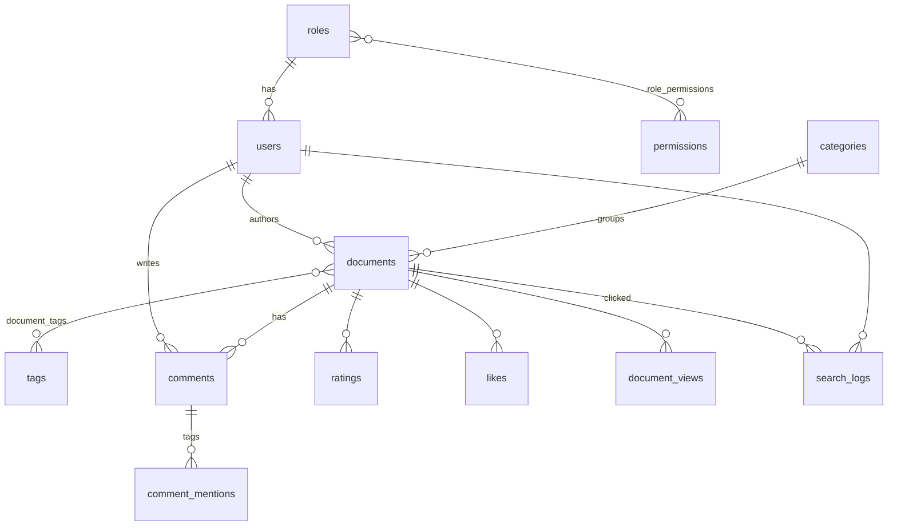

# Enterprise Document & Research Repository

A full-stack web application for publishing and finding internal policies, procedures and research reports.
Phase 1 delivers complete CRUD, authentication and Role-Based Access Control (RBAC). It also lays the
groundwork for Phase 2 (tokenization, inverted index, BM25/TF-IDF ranking) with a clean **Document Store**
and a standardized **Search & Click Log**.

| Layer | Technology |
|---|---|
| Backend | Python 3.11+ · **FastAPI** (RESTful API, OpenAPI docs at `/docs`) · SQLAlchemy 2.0 · JWT (PyJWT) · bcrypt |
| Database | **PostgreSQL 16** (document store, logs, RBAC) |
| Frontend | **React 18** + React Router + Vite, responsive (desktop → 360 px mobile) |
| Tests | pytest + FastAPI TestClient against a real PostgreSQL database (18 tests) |
| DevOps | Docker Compose (db + api + web), Git |

---

## 1. Quick start

### Option A — Docker (one command)

```bash
docker compose up --build
```

* Web app: <http://localhost:5173>
* API docs (Swagger): <http://localhost:8000/docs>

Demo data is seeded automatically the first time the backend starts.

### Option B — Run locally

Prerequisites: Python 3.11+, Node 18+, PostgreSQL 14+.

```bash
# 1. Database
psql -U postgres -c "CREATE USER docrepo WITH PASSWORD 'docrepo' CREATEDB;"
psql -U postgres -c "CREATE DATABASE docrepo OWNER docrepo;"

# 2. Backend
cd backend
python -m venv .venv
source .venv/bin/activate          # Windows: .venv\Scripts\activate
pip install -r requirements.txt
cp .env.example .env               # edit DATABASE_URL / SECRET_KEY if needed
python -m seed.seed --reset        # create tables + load demo data
uvicorn app.main:app --reload --port 8000

# 3. Frontend (new terminal)
cd frontend
npm install
npm run dev                        # http://localhost:5173 (proxies /api → :8000)
```

### Demo accounts

All accounts use the password **`Password123!`**

| Username | Role | What to try |
|---|---|---|
| `superadmin` | Super Admin | Users, role permissions matrix, global settings, system log |
| `content.manager` | Content Manager | Create/edit/delete documents, publish/unpublish, categories & tags |
| `editor.hoang` | Content Manager | (second editor) |
| `moderator` | Moderator | Comment queue, reports/flags, spam keyword filter |
| `seo.analyst` | Data & SEO Specialist | SEO metadata editor, analytics dashboard, search & click log |
| `sarah.lee`, `john.carter`, … | Member | Comment, @mention, like, rate, report, edit profile |

---

## 2. Requirements coverage

### A. Client / user interface

| Requirement | Where |
|---|---|
| Home & directory: paginated latest items with summaries | `/` — 10 per page (configurable), newest first, summary + author + date + views + tags |
| Detail view: full content, image, metadata (author, date, view count, categories, tags) | `/documents/:slug` — view counter increments on each visit, related documents |
| Registration, login, profile management | `/register`, `/login`, `/profile` (edit details, avatar URL, change password) |
| Commenting | Threaded comments (one reply level), edit/delete own comments |
| Rating / liking | 1–5 star rating and like toggle per user |
| User tagging | `@username` mentions with autocomplete; mentioned users see them in **Profile → Mentions** |
| Keyword search (LIKE / regex) | Header search box → `ILIKE` on title, summary and content; every word must match; wildcards escaped; matches highlighted |
| Filters: category, tag, date range | Sidebar filters (combinable with the keyword), plus document type and sort |

### B. Admin interface (RBAC)

| Role | Core responsibilities | Implemented in `/admin` |
|---|---|---|
| **Super Admin** | Manage users/roles, assign permissions, view system logs, global settings | Users (create, change role, deactivate, reset password, delete), Roles & permissions matrix (editable), System log (audit trail incl. failed logins), Global settings |
| **Content Manager** | Full CRUD on content, publish/unpublish, taxonomy | Documents list + editor, Publish/Unpublish/Archive, Categories & tags CRUD |
| **Moderator** | Review comments, handle flags/reports, spam control | Comment queue (pending/reported/spam/hidden), Reports (resolve, hide target, dismiss), Spam keyword blocklist (auto-flags new comments) |
| **Data & SEO Specialist** | SEO metadata, analytics dashboards | SEO editor with issue checker & search-result preview, Analytics (views, searches, CTR, top/zero-result queries), Search & click log + CSV export |

RBAC is **permission-based**: roles are rows in the database and each role owns a set of permission codes.
Every protected endpoint declares the permission it needs, so the Super Admin can change what a role may do
at runtime. Safety rules: the last active Super Admin cannot be demoted/deleted, and the Super Admin role
always keeps `users.manage` and `roles.manage`.

| Permission | Super Admin | Content Manager | Moderator | Data & SEO | Member |
|---|:-:|:-:|:-:|:-:|:-:|
| `users.manage`, `roles.manage`, `logs.view`, `settings.manage` | ✔ | | | | |
| `documents.create/update/delete/publish`, `taxonomy.manage` | ✔ | ✔ | | | |
| `documents.read_all` (see drafts) | ✔ | ✔ | | ✔ | |
| `comments.moderate`, `reports.manage`, `spam.manage` | ✔ | | ✔ | | |
| `seo.manage`, `analytics.view` | ✔ | | | ✔ | |

---

## 3. Data schema & Phase 2 preparation



### Documents table (`documents`)

| Required field | Column |
|---|---|
| id | `id` (PK) |
| title | `title` |
| content (plain text / HTML) | `content` — plain text, paragraphs separated by blank lines |
| summary | `summary` |
| category_id | `category_id` → `categories.id` |
| tags | many-to-many via `document_tags` → `tags` |
| author | `author_id` → `users.id` |
| created_at | `created_at` (timestamptz) |
| views_count | `views_count` |

Extra columns: `slug`, `doc_type`, `department`, `status` (draft/published/archived), `published_at`,
`updated_at`, `cover_image_url`, SEO fields (`seo_title`, `seo_description`, `seo_keywords`, `cover_image_alt`).

**Flat corpus view for the indexer** — `search_corpus` exposes exactly the required fields in one row per
document (tags as a text array, author as a display name):

```sql
SELECT id, title, content, summary, category_id, tags, author, created_at, views_count
FROM search_corpus WHERE status = 'published';
```

### Search & click log (`search_logs`)

| Required field | Column |
|---|---|
| user_id | `user_id` (NULL for guests) |
| query_string | `query_string` |
| clicked_doc_id | `clicked_doc_id` (NULL on search events) |
| timestamp | `timestamp` |

Extra columns for relevance work: `event_type` (`search` / `click`), `session_id` (groups a query with its
clicks), `rank_position` (1-based position of the clicked result → position-bias correction),
`results_count` (zero-result detection) and `filters` (JSONB).
The frontend logs a `search` event whenever a keyword search runs and a `click` event when a result is
opened. Export: `GET /api/analytics/search-logs.csv` or the **Download CSV** button.

### Seed data

`python -m seed.seed --reset` loads deterministic, realistic data (no Lorem Ipsum):

* **61 documents** (55 published, 4 drafts, 2 archived) written for a fictional company — HR policies,
  security standards, architecture decision records, runbooks, postmortems, finance procedures, legal
  policies, market research and product requirements; ~1,250 characters each
* 8 categories, 105 tags, 13 users across all 5 roles
* ~110 comments with replies and @mentions, ~210 likes, ratings, ~6,500 view events over 45 days
* **420 search events + ~270 click events** with realistic position bias, including zero-result queries
* Moderation examples: a spam comment, a pending comment, open reports

---

## 4. API overview

Interactive documentation: **<http://localhost:8000/docs>**. Authentication uses
`Authorization: Bearer <token>` from `/api/auth/login`.

| Method | Path | Access |
|---|---|---|
| POST | `/api/auth/register` · `/api/auth/login` | public |
| GET/PUT | `/api/auth/me` · POST `/api/auth/change-password` | signed in |
| GET | `/api/me/mentions` · POST `/api/me/mentions/read` | signed in |
| GET | `/api/documents` (`q`, `category`, `tag`, `doc_type`, `date_from`, `date_to`, `sort`, `page`, `page_size`) | public |
| GET | `/api/documents/{id or slug}` · `/related` · `/comments` · `/engagement` | public |
| POST/PUT/DELETE | `/api/documents/{id}/comments` · `/api/comments/{id}` · `/like` · `/rating` · POST `/api/reports` | signed in |
| GET | `/api/categories` · `/api/tags` · `/api/documents/doc-types` · `/api/documents/popular` · `/api/site` | public |
| POST | `/api/logs/click` | public |
| GET/POST/PUT/DELETE | `/api/admin/documents…` · PATCH `/api/admin/documents/{id}/status` | `documents.*` |
| GET/POST/PUT/DELETE | `/api/admin/categories…` · `/api/admin/tags…` | `taxonomy.manage` |
| GET/PATCH/DELETE | `/api/moderation/comments…` · `/stats` | `comments.moderate` |
| GET/PATCH | `/api/moderation/reports…` | `reports.manage` |
| GET/POST/DELETE | `/api/moderation/spam-keywords…` | `spam.manage` |
| GET/PUT | `/api/seo/documents…` | `seo.manage` |
| GET | `/api/analytics/summary` · `/search-logs` · `/search-logs.csv` | `analytics.view` |
| GET/POST/PUT/DELETE | `/api/admin/users…` | `users.manage` |
| GET/PUT | `/api/admin/roles` · `/api/admin/permissions` · `/api/admin/roles/{id}/permissions` | `roles.manage` |
| GET | `/api/admin/system-logs` | `logs.view` |
| GET/PUT | `/api/admin/settings…` | `settings.manage` |

---

## 5. Tests

```bash
psql -U docrepo -d docrepo -c "CREATE DATABASE docrepo_test;"   # once
cd backend
pytest -q          # uses TEST_DATABASE_URL, default .../docrepo_test (wiped and re-seeded)
```

The suite covers pagination, detail/view counting, draft visibility, keyword search with filters and
logging, click logging, the Phase 2 corpus view, registration/login/profile, validation, a full RBAC matrix
(every admin endpoint × every role), document CRUD and publishing, taxonomy, comments/mentions/likes/
ratings/reports, the spam filter, moderation, SEO, analytics and every Super Admin function.

---

## 6. Project structure

```
backend/
  app/
    main.py            FastAPI app, CORS, router registration
    models.py          SQLAlchemy models (documents, search_logs, RBAC, …)
    schemas.py         Pydantic request/response models
    permissions.py     Permission catalogue + default roles + default settings
    deps.py            Auth dependencies and require_permissions()
    db_init.py         Creates tables, the search_corpus view and the RBAC baseline
    routers/           auth, documents, engagement, taxonomy, moderation, admin, analytics
  seed/                seed.py + 4 files of realistic documents
  tests/               pytest suite (real PostgreSQL)
frontend/
  src/
    pages/             Home, DocumentPage, Login, Register, Profile
    pages/admin/       Workspace pages, one per responsibility
    components/        Layout, DocCard, Comments, Pagination, …
    api/client.js      fetch wrapper, session id, click logging
docker-compose.yml
```

## 7. Roadmap to Phase 2

1. Read `search_corpus`, tokenize (lower-case, split on non-alphanumerics, stop words, light stemming).
2. Build an inverted index `term → [(doc_id, tf)]` plus document lengths.
3. Score with TF-IDF and BM25 (`k1≈1.2–2.0`, `b≈0.75`), replacing the `ILIKE` query in
   `GET /api/documents` without changing the API contract.
4. Evaluate against the Phase 1 baseline using `search_logs` (CTR, mean clicked rank, zero-result rate).
